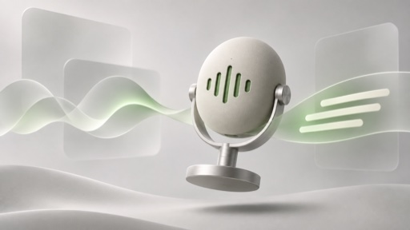
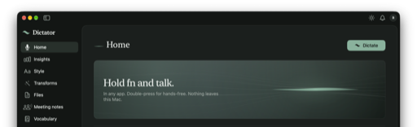
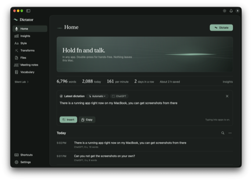
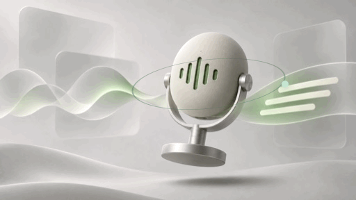

<h1 align="center">Dictator</h1>

<p align="center"><strong>Speak naturally. Keep your words. Stay in flow.</strong><br>
A native macOS dictation studio for turning speech into editable text — on your Mac.</p>

<p align="center">
  <a href="#first-dictation"></a>
  <a href="https://github.com/ruddvz/dictator/actions/workflows/ci.yml"></a>
  <a href="LICENSE"></a>
  
</p>

<p align="center">
  
</p>

<p align="center"><em>Your voice, already where you need it.</em></p>

Dictator is built for the moment between having a thought and getting it onto the page. Hold **fn (Globe)**, speak, review the words, then copy or insert them into a supported app. Shape drafts, transcribe audio, and capture meeting notes with tools that work locally.

## See Dictator

<p align="center">
  
  &nbsp;&nbsp;
  
</p>

<p align="center"><sub>Live captures from the running Mac app. The Home image is cropped to keep local transcript history private.</sub></p>

### Voice becomes text, stays on-device

<p align="center">
  
</p>

## What Dictator does

| Speak | Shape | Send |
| --- | --- | --- |
| Live dictation from a button or the **fn (Globe)** key. Apple Speech is ready to use; optional Parakeet models run locally after download. | Natural, Message, Email, Code, or Automatic modes, plus local vocabulary, snippets, corrections, and review-first transforms. | Copy or use guarded insertion in supported text fields. Recheck the destination and undo a recent insertion. |

### One workspace for voice and writing

- **Dictation:** Words appear as you speak with Apple Speech. Choose local Parakeet if you want its batch-style transcript, or let Dictator fall back to Apple Speech when a model or language is unavailable.
- **Writing controls:** Set Automatic mode per app, add vocabulary and snippets, define correction rules, and restore the original transcript at any time.
- **Local transforms:** Make a reviewable draft that is polished, concise, professional, formatted as bullets, or organized as action items. Filler cleanup also works without Apple Intelligence.
- **Voice edit:** Select text in another app, speak an instruction, review the proposed edit, and apply it only when it is ready.
- **File transcription:** Transcribe one audio file at a time and export text, SRT, or WebVTT. Apple Speech needs no model download; WhisperKit is an optional local engine.
- **Meeting notes:** Capture your microphone, Mac system audio, or both. Search and edit local transcripts, then export them as text.
- **Silent Lab:** Train and evaluate a small vocabulary from headphone motion. This research experiment is not general lip reading.

## First dictation

1. Open Dictator and hold **fn (Globe)**, the default global shortcut, or select **Dictate** in Home. The shortcut is configurable in **Settings → Shortcuts**.
2. Speak naturally, then release or stop. Review and edit the transcript.
3. Choose **Copy**, or turn on **Insert into current app** and grant Accessibility access to insert into a supported text field.

Apple Speech streams text as you talk. Parakeet returns a transcript when you finish. Dictator listens only while you start a recording.

## Made to stay local

- Speech recognition and text processing run on this Mac. There is no telemetry, paid API, or remote speech-recognition fallback.
- Optional speech models download only after you request them; the model files then run locally. Downloads require internet.
- Ordinary dictation audio is not written to disk. Transcript history is stored locally and can be disabled or cleared in Settings.
- Meeting audio is not saved; its transcript is stored when you stop.
- Nearby-text hints are off by default. When enabled, a bounded text slice is used to find recognition terms and then discarded.
- Silent Lab's separate research recorder saves audio only when you explicitly enable it.

Microphone access begins when you start capture. Accessibility is used for the fn shortcut and text insertion; System Audio Recording is requested when you start a system-audio meeting; Motion access is requested only when you open **Silent Lab → Connect**.

## Compatibility

| Capability | Needs |
| --- | --- |
| Core app and live dictation | macOS 14 or later; Apple Silicon and Intel Macs |
| System-audio meeting capture | macOS 14.2 or later |
| Apple Intelligence transforms, meeting summaries, and voice edit | macOS 26 or later, with Apple's on-device Foundation Model available |
| Silent Lab | Compatible head-tracking headphones connected as the Mac's audio output |

Dictation does not require headphones. Model languages, performance, and availability vary by Mac and selected engine. Generated drafts can change meaning, so review them before applying.

## Get Dictator

Build the app on a Mac with Xcode, the macOS SDK, and XcodeGen:

```sh
brew install xcodegen
git clone https://github.com/ruddvz/dictator.git
cd dictator
./Scripts/package-app.sh
open dist/Dictator.app
```

## For contributors

Generate the Xcode project and run the suite:

```sh
xcodegen generate
xcodebuild -project Dictator.xcodeproj -scheme Dictator -derivedDataPath .build CODE_SIGNING_ALLOWED=NO test
```

[GitHub Actions](https://github.com/ruddvz/dictator/actions/workflows/ci.yml) builds and tests on macOS. For evaluation fixtures, splits, and local scoring, see [the evaluation guide](Fixtures/eval/README.md).

## Explore more

- [Personal-data backup guide](docs/PERSONAL_DATA_BACKUP.md)
- [Testing protocol](docs/TESTING_PROTOCOL.md)
- [Product plan and file map](docs/PRODUCT_PLAN.md)
- [Third-party notices and license boundaries](NOTICE.md)

Dictator is released under the [MIT License](LICENSE). Third-party components retain their own licenses; see [NOTICE.md](NOTICE.md) and `docs/licenses/`.
