<div align="center">
  
  <h1>Dictator</h1>
  <p><strong>Hold <kbd>fn</kbd>. Speak. Your words appear in any Mac app.</strong><br>
  A fast, private, open-source dictation app for macOS, and an alternative to Wispr Flow.</p>
  <p>
    <a href="https://github.com/ruddvz/dictator/releases/latest"></a>
    <a href="LICENSE"></a>
    
  </p>
  <p><a href="#install">Install</a> · <a href="#using-dictator">Using it</a> · <a href="#features">Features</a> · <a href="#shortcuts">Shortcuts</a> · <a href="#privacy">Privacy</a> · <a href="#troubleshooting">Troubleshooting</a> · <a href="#contributing">Contributing</a></p>
</div>

<p align="center">
  
</p>

Dictator turns speech into clean text wherever your cursor is: Messages, Slack, your editor, a browser, a terminal. Hold the **fn (Globe)** key, talk, and let go. Recognition runs **on your Mac**, filler words are tidied up, and you choose whether text is typed straight into the field or shown for review first.

<p align="center">
  
</p>

## Install

Dictator needs **macOS 14 or later** (Apple silicon or Intel). There is no notarized release yet, so pick one of two routes.

| | Download the DMG | Build from source |
|---|---|---|
| **Best for** | Trying it in a minute | Daily use |
| **Needs** | Nothing | Full Xcode, plus Homebrew if XcodeGen is missing |
| **First open** | macOS blocks it once; you allow it (steps below) | Opens normally |
| **Updates** | Download the new DMG; re-allow it; you may need to switch Accessibility off and on | `git pull && ./Scripts/install.sh`; permissions persist |

### Option A: download

1. Get `Dictator-<version>.dmg` from the [latest release](https://github.com/ruddvz/dictator/releases/latest) and drag **Dictator** onto **Applications**.
2. Open it. macOS says it can't verify the app, because it isn't notarized. Click **Done**, open **System Settings → Privacy & Security**, scroll down, click **Open Anyway** next to Dictator, and confirm. You do this once per downloaded version.
   Terminal alternative: `xattr -dr com.apple.quarantine /Applications/Dictator.app`

### Option B: build from source (recommended)

```sh
git clone https://github.com/ruddvz/dictator.git
cd dictator
./Scripts/install.sh
```

The installer checks your Mac, installs XcodeGen if needed, creates a stable local signing identity, builds the app, copies it to `/Applications`, and opens it. The first build takes several minutes. Run `./Scripts/install.sh --check` to test prerequisites without building. If macOS asks whether `codesign` may use "Dictator Local Signing", choose **Always Allow**.

Because the app is signed with *your* local identity, macOS keeps its Accessibility permission across updates. Do not run raw builds from `.build/`; always install through the script.

### First launch

1. Allow **Microphone** and **Speech Recognition** when macOS asks.
2. Switch Dictator on under **System Settings → Privacy & Security → Accessibility**. This is what lets **fn** start dictation and lets Dictator type into other apps.
3. For the best accuracy, open **Settings → Dictation** and choose **Parakeet**. It downloads once (about 600 MB) and then works offline.

## Using Dictator

- **Dictate:** focus a text field, hold **fn**, speak, release. The text is typed into the field. Password fields are always skipped.
- **Hands-free:** double-press **fn**, talk as long as you like, press **fn** once to stop.
- **Review first:** turn off **Settings → Typing → Type into the focused field**, or start from **Home**. Edit the transcript, then **Copy** it and paste with **⌘V**.
- **Cancel:** press **esc** while dictating. **Undo insertion** (⌥⇧U) restores the field's original contents.
- **Edit by voice:** select text anywhere, hold **⌥⇧E**, and say the change ("make this shorter").

When a web or Electron app (Chrome, Slack, VS Code, Codex) doesn't accept direct insertion, Dictator falls back to pasting with ⌘V and then restores your clipboard.

## Features

- **Two speech engines for dictation.** *Apple Speech* runs on-device for supported languages. *Parakeet* is a downloadable local model (English) that is more accurate and returns text when you release the key.
- **Your vocabulary.** Add names and spellings, correction rules and reusable snippets. Parakeet prefers your words when the audio is close; a built-in list covers common tech names.
- **Cleanup levels.** *Raw* keeps every word, *Clean* removes um/uh/stutters and false starts, *Polished* also uses an on-device model for punctuation and fillers.
- **Tone per context.** Set formal, casual or very casual styles for personal messages, work messages, email and other apps. Code is never restyled.
- **Per-app profiles.** Dictator adapts its mode and vocabulary to the app you are typing into.
- **Transforms.** Polish, make concise, professional tone, bullet points, action items, remove fillers, or write your own. Apple Intelligence options need macOS 26 or later and an available on-device model.
- **Files.** Turn audio or video into text on this Mac with Parakeet, Apple Speech or a downloaded WhisperKit model. Export text, SRT or WebVTT (subtitle timing needs Apple Speech or WhisperKit).
- **Meeting notes.** Transcribe your microphone, Mac audio, or both as a meeting happens; get a local summary and action items. Source audio is not saved. System-audio capture needs macOS 14.2 or later. Speaker identification is not included.
- **Insights.** Words dictated, speed, streaks and time saved, all counted on your Mac.
- **Silent Lab.** An experimental area for capturing mouthed words.

## Shortcuts

All of these can be changed in **Settings → Shortcuts**.

| Action | Default |
|---|---|
| Dictate (hold) | **fn** |
| Hands-free | **fn fn** |
| Paste last dictation | **⌃⌘V** |
| Cancel dictation | **esc** |
| Edit selected text by voice | **⌥⇧E** |
| Paste again (re-type the latest output) | **⌥⇧I** |
| Undo insertion | **⌥⇧U** |
| Silent capture | **⌥⇧M** |
| Hide or show the sidebar | **⌃⌘S** |
| Settings | **⌘,** |

## Privacy

- **Speech stays on your Mac.** Apple Speech uses on-device recognition. If macOS can't recognize your language on-device, Dictator stops and says so; it never sends audio to a remote recognizer.
- **Local models only.** Parakeet, WhisperKit and the Polished cleanup model are downloaded once when you choose them, then run offline. Those model downloads are the only network use, and there is no analytics or tracking code.
- **Audio isn't kept.** Dictation audio stays in memory while it is processed. Meeting and file transcripts are saved on your Mac as text.
- **History is yours.** Turn it off, set an expiry, or delete it in **Settings → Data & privacy**. You can export and back up your personal data; see the [personal data and backup guide](docs/PERSONAL_DATA_BACKUP.md).
- **No account, no cloud, no analytics.**

## Troubleshooting

| Problem | Fix |
|---|---|
| **fn does nothing** | Switch Dictator on under Privacy & Security → Accessibility. If it's already on, switch it off and on again (needed after updating a DMG build). Check that System Settings → Keyboard doesn't map the Globe key to the emoji picker or another action. |
| **macOS says the app can't be opened** | The DMG isn't notarized. Use **Open Anyway** in Privacy & Security, or install from source. |
| **Text doesn't appear in an app** | Turn on **Settings → Typing → Paste fallback**, or use Review first and paste with ⌘V. |
| **Words are misheard** | Choose Parakeet in Settings → Dictation, then add the word under **Vocabulary**. |
| **The first Parakeet use is slow** | The model downloads and prepares once (about 600 MB). |
| **Build fails** | Run `./Scripts/install.sh --check`. You need full Xcode (not just the Command Line Tools), opened once to accept the license. |

## Known limits

- Not notarized yet; a one-click install needs an Apple Developer ID.
- Parakeet is English-only, and language is chosen manually.
- Direct insertion has not been verified in every app. If a field misbehaves, please [open an issue](https://github.com/ruddvz/dictator/issues) with the app name and macOS version.

## Contributing

Issues and pull requests are welcome.

```sh
./Scripts/test.sh
```

Tests run locally; the GitHub workflow is manual-only.

Work on `main` with small, focused commits, and record what you finished in [PROGRESS.md](PROGRESS.md). Agents and contributors should read [AGENTS.md](AGENTS.md) first: it explains the signing rule above and the text-insertion rules that must not be reverted. The [documentation index](docs/README.md) covers design, testing and research. Maintainers can build a shareable, unnotarized disk image with `./Scripts/make-dmg.sh`.

## License and credits

Dictator is [MIT-licensed](LICENSE). Speech models and libraries (FluidAudio, WhisperKit and others) carry their own licenses; see [NOTICE.md](NOTICE.md).
